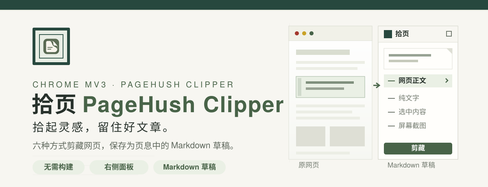
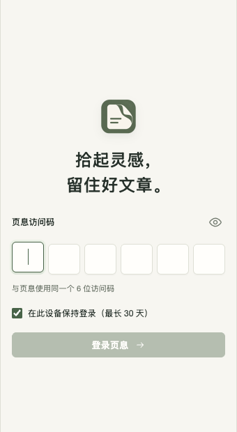
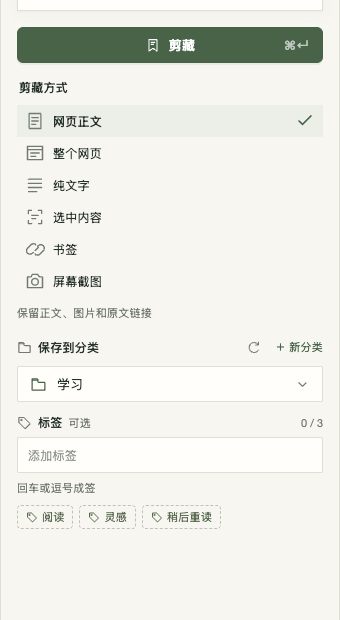
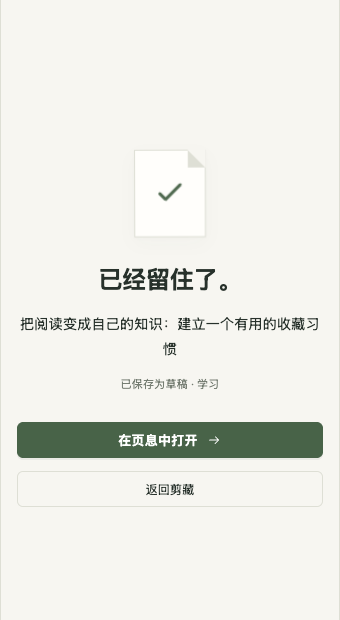

<p align="center">
  
</p>

**拾页 PageHush Clipper** 是一个 Chrome MV3 网页剪藏扩展。它用页息 PageHush 的 6 位访问码登录，把网页整理成 Markdown 草稿，适合在阅读时快速留下正文、选区、书签或当前可见画面。

默认连接线上页息：**https://pagehush.yohoia.cn**。API 与网页共用该域名，接口前缀为 `/v1`，无需手填 API 地址，也不需要构建或打包。

## 真实界面

| 登录 | 选择剪藏方式 | 保存成功 |
| --- | --- | --- |
|  |  |  |

## 快速开始

<p align="left">
  <a href="https://github.com/Yohoia/yoho-web-clipper/releases/latest/download/shiye-chrome-extension.zip"><strong>下载最新版扩展包</strong></a>
</p>

下载后解压 `shiye-chrome-extension.zip`，再按以下步骤加载：

1. 在 Chrome 打开 `chrome://extensions/`，开启「开发者模式」。
2. 点击「加载已解压的扩展程序」，选择解压后的 `shiye-chrome-extension` 目录。
3. 打开任意普通网页，点击工具栏中的「拾页」，右侧会打开剪藏面板。
4. 首次使用时，在六个格子中输入页息的 **6 位访问码**。输入会自动跳转，支持退格、左右方向键和完整粘贴。
5. 按需修改标题、分类与标签，选择剪藏方式。
6. 点击「剪藏」，或按 **Command / Ctrl + Enter** 保存草稿；成功后可点击「在页息中打开」继续编辑。

更新扩展文件后，请在 `chrome://extensions/` 点击拾页的「重新加载」，再刷新要剪藏的网页。Chrome 内部页和扩展商店不能注入面板，请在普通网页上使用。

## 六种剪藏方式

| 方式 | 保存内容 |
| --- | --- |
| 网页正文 | 自动识别正文，保留图片、链接、列表、代码和表格，清理导航与广告 |
| 整个网页 | 当前主文档的文字、图片、导航和页脚，转换为可编辑 Markdown；不复制网页样式 |
| 纯文字 | 正文文字、链接和结构，移除图片与封面 |
| 选中内容 | 当前在网页中选中的内容 |
| 书签 | 标题、摘要和原文链接 |
| 屏幕截图 | 保存时当前可见区域；隐藏拾页面板后截图，上传为图片并保存带来源的草稿 |

截图不包含浏览器工具栏，不滚动抓取长图，也不提供裁剪或标注。超过页息 5MB 限制时会提示缩小窗口；图片存储未配置时明确报错并保留输入。截图前后会核对活动标签页与原 URL，切换网页后需要回到原页重试。

## 本地导出

剪藏面板主按钮下方提供两种本地导出：

- **导出 MD**：下载单份 `.md` 文件，包含标题、来源信息和当前剪藏方式的 Markdown 正文。
- **导出压缩包**：下载 `.zip`，包含 `article.md` 与 `assets/` 目录；可下载的远程 JPEG / PNG / WebP 图片会保存到本地，并把 Markdown 链接改写为相对路径。

压缩包导出同样遵守单张 5MB、最多 30 张、总计 50MB 的限制；单张图片下载失败时保留原站链接，不阻止导出。导出使用浏览器下载权限，不需要 PageHush 存储已配置。

## 图片处理

从 0.5.5 开始，「网页正文」「整个网页」和「选中内容」中的远程 JPEG / PNG / WebP 图片会被归档到页息：

- 下载图片时不发送页息来源的 Referer，兼容微信公众号等防盗链图片。
- 上传为 `inline_image` 资产后，把 Markdown 中的原站图片链接替换为页息资产链接。
- 单张图片最大 5MB，单次最多归档 30 张、总计 50MB。
- 单张图片下载或上传失败时保留原站外链，不会阻止文字内容保存。
- 已保存的旧草稿不会被自动迁移；重新剪藏原文可获得归档图片。
- 「纯文字」继续移除图片；「书签」仍使用网页元信息封面；「屏幕截图」仍上传为封面资产。

## 保存与恢复

- 文章链接使用页息返回的固定短标识，格式为 `/a/22位数字字母`，地址中不包含中文标题。
- 连接尚未更新的页息 API 时，自动使用已有 UUID 地址 `/articles/UUID`，仍可打开草稿。
- 标题、标签、分类和剪藏方式的未保存输入会暂存在当前浏览器会话；重新打开同一个网页时恢复。
- 保存由后台完成。关闭面板后再次打开，可以恢复保存结果，不会自动重发创建请求。
- 超时或中断时，建议先到页息查看草稿，避免手动重试造成重复。

### 分类与标签

- 登录后自动获取分类，默认选择最近使用的分类、已有的「学习」分类或首个分类。
- 没有分类时，保存会自动创建「学习」；点击「＋ 新分类」可以指定其他分类。
- 最多添加 3 个标签，每个标签最多 40 个字。输入后按回车或逗号生成签条，也可批量粘贴、点选已有标签、点击叉号移除；空输入时退格移除最后一签。
- 未按回车的标签会在保存时自动确认。

## 登录、隐私与会话

- 不保存访问码，只保存服务端返回的 session token。
- 勾选「保持登录」：token 保存到 `chrome.storage.local`，最长 30 天，以服务端到期时间为准。
- 不勾选：token 只保存到 `chrome.storage.session`，浏览器关闭或扩展重新加载后需要重新登录。
- API 请求统一由扩展后台发起，使用 `x-pagehush-session`，不依赖网页 Cookie。
- 未登录时不请求分类、不采集正文；已登录后才提取待保存内容，也不显示正文预览。
- 网络错误保留登录；401 或到期才清除凭证。
- 退出登录会撤销服务端会话并清除此设备凭证。服务暂时不可达时仍清除本地凭证，并说明服务端撤销未完成。

## 面板与交互

- 面板默认宽 340px，上下和右侧各留 12px，高度随浏览器内容区变化；较窄窗口下自动缩小宽度。
- 页头与底部账户栏固定，中间内容独立滚动；「剪藏」按钮位于标题与剪藏方式之间，滚动时保持可见。
- 右上角「×」、Esc 或再次点击工具栏「拾页」可以关闭；重开会恢复当前网页的未保存输入。
- 六格访问码逐格聚焦，填满后启用登录；错误访问码给出轻微摇动反馈。
- 六种剪藏方式纵向排列，左侧为线条图标，选中行用浅色底与右侧绿色勾号标记，切换时重新读取内容。
- 当前文章呈现为折角纸页；保存期间纸页轻轻收拢，收到成功响应后显示完成勾号。
- 分类菜单支持搜索、上下方向键、回车选择和 Esc 关闭；标签成签时轻轻落入纸面。
- 系统开启「减少动态效果」时，动画自动简化。
- 右上角「复制链接」复制完整原文地址，成功后短暂显示「已复制」。
- 左下角「关于拾页」会在当前面板内显示绿色装帧介绍，Esc 或返回箭头回到剪藏并保留输入与滚动位置。

界面使用 Helvetica Neue、Lucida Grande 与中文苹方，延续暖白纸面、墨绿控件、直角面板与小圆角控件。开发用默认地址集中在 `src/config.js`；旧版本明确保存的自定义服务配置继续兼容，0.1.0 的默认本机地址会自动迁移到线上。

## 开发验证

```bash
node --check src/background.js
node --check src/content.js
node --check src/panel.js
node --check popup/popup.js
node --check options/settings.js
node --check src/preferences.js
node tests/check.mjs
```

集成检查需要 Playwright 与其 Chromium 浏览器。当前环境会自动复用相邻 PageHush 项目的 Playwright，也可以通过 `PLAYWRIGHT_MODULE` 指定模块路径。检查使用临时浏览器配置和独立的本机模拟 API，不读取现有浏览器账号，也不向线上写入草稿。

界面预览：

```bash
node tests/preview-server.mjs
```

- 完整网页右侧预览：`http://127.0.0.1:4318/panel-preview?state=clip`
- 面板内关于页：`http://127.0.0.1:4318/panel-preview?state=clip&view=about`
- 状态预览：`http://127.0.0.1:4318/preview?state=login`，支持 `login`、`clip`、`success`、`empty`、`offline`、`save-error`

此入口仅供本机设计验证，生产扩展不加载模拟接口。历史剪藏方式小样已在仓库清理中移除，当前界面以纵向六项列表为准。

## 项目结构

<details>
<summary>查看主要文件</summary>

```text
.
├── manifest.json           # 可直接加载的 Chrome MV3 扩展
├── clipper-logo.png        # 用户提供的原始 Logo
├── icons/                  # 原始 Logo 导出的各尺寸工具栏图标
├── popup/                  # 登录、剪藏、成功和连接恢复
├── options/                # 关于拾页与扩展详情兼容入口
├── src/
│   ├── preferences.js      # 剪藏偏好默认值和白名单解析
│   ├── config.js           # 线上默认地址、URL 校验和旧配置迁移
│   ├── background.js       # 登录、topics/tags、截图上传与保存
│   ├── panel.js            # 网页右侧面板、样式隔离和关闭
│   └── content.js          # 页面采集与 HTML → Markdown
├── tests/
│   ├── check.mjs           # 隔离 Chrome 扩展集成检查
│   ├── preview-server.mjs  # 本机界面预览入口
│   └── preview-api.js      # 仅用于预览的模拟接口
└── docs/                   # 设计说明、实现记录、最终截图与动效阶段图
```

`AGENT.md` 是项目协作规范，`plan.md` 记录实施计划。`clipper01` 仅作只读参考，不参与扩展加载，也未复制其打包代码或官方素材。

</details>

## 当前范围

已实现六种剪藏、分类、标签、草稿保存、会话恢复、输入恢复、面板内关于页、正文图片归档和本地 Markdown / ZIP 导出。尚未实现截图标注、滚动长截图、查重提示、PDF / Gmail 专用适配；复杂网页可优先使用「选中内容」或「书签」。

正文、整页和选区中的受支持远程图片会上传到页息并替换 Markdown 链接；书签封面保留元信息外链，屏幕截图上传到页息。线上健康接口和扩展登录接口已确认可达；真实访问码登录和线上草稿写入需使用你自己的访问码验证。

## 更多文档

| 主题 | 文档 |
| --- | --- |
| 面板内关于页 | [docs/about-inline-design.md](docs/about-inline-design.md) |
| 剪藏操作与状态 | [docs/clip-actions-design.md](docs/clip-actions-design.md) |
| 纵向剪藏方式 | [docs/vertical-modes-design.md](docs/vertical-modes-design.md) |
| 交互与设置 | [docs/interaction-design.md](docs/interaction-design.md) · [docs/settings-design.md](docs/settings-design.md) |
| 实现与验证 | [docs/implementation.md](docs/implementation.md) |
| 发布扩展包 | [docs/release.md](docs/release.md) |
